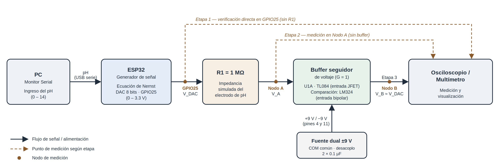
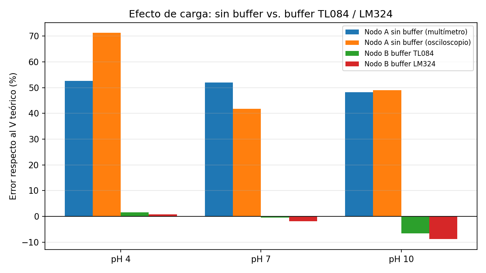

# IB III – Laboratorio 1: Acondicionamiento de señales de alta impedancia

Instrumentación Biomédica III · Escuela Profesional de Ingeniería Biomédica · UNMSM

Un electrodo de vidrio para pH se comporta como una fuente de voltaje con una resistencia interna de 10⁶–10⁹ Ω. En este laboratorio se simula ese electrodo con el DAC de un ESP32 y una resistencia serie de 1 MΩ, se observa el error de carga que produce al medirlo directamente y se corrige con un buffer seguidor de voltaje, comparando un op-amp de entrada JFET (TL084) con uno de entrada bipolar (LM324).

## Objetivos

- Identificar experimentalmente el efecto de carga (*loading error*) al conectar una fuente de alta impedancia a un instrumento de medición.
- Diseñar e implementar un buffer de alta impedancia de entrada con un op-amp de entrada JFET (TL084).
- Comparar el desempeño de un buffer con op-amp de entrada bipolar (LM324) frente a uno de entrada JFET (TL084).
- Generar con un ESP32 una señal simulada de electrodo de pH en tres puntos de referencia (pH 4, 7 y 10) y usarla para poner a prueba el buffer.

## Fundamento en breve

| Concepto | Expresión |
|---|---|
| Ecuación de Nernst (25 °C) | E = E₀ − 0.05916 V/pH · (pH − 7) |
| Señal simulada en GPIO25 | V = 1.65 V − 4 · 0.05916 V/pH · (pH − 7) |
| Efecto de carga | V_medido = V_fuente · Z_entrada / (Z_entrada + Z_fuente) |
| Error porcentual | (V_teórico − V_medido) / V_teórico · 100 |

Con una fuente de 1 MΩ y un instrumento de ~1 MΩ de entrada, el divisor de voltaje produce un error cercano al 50 %. El TL084 (entrada JFET) tiene una corriente de polarización del orden de pA y una impedancia de entrada de ~10¹² Ω, por lo que prácticamente no carga a la fuente. El LM324 (entrada bipolar) tiene corrientes de polarización del orden de nA, suficientes para dejar un error residual con fuentes de muy alta impedancia.

## Estructura

```
firmware/lab1_ph_esp32/lab1_ph_esp32.ino   Simulador de electrodo de pH (Arduino IDE, ESP32)
data/mediciones_lab1.csv                   Voltajes medidos en las tres etapas
analysis.py                                Errores porcentuales y gráfica comparativa
docs/diagrama_bloques.png                  Diagrama de bloques del montaje
docs/esquematicos/esquematico_simulacion.pdf   Esquemático (ESP32 + R1 + buffer TL084 / LM324)
docs/error_carga.png                       Gráfica de errores (la genera analysis.py)
docs/guia/                                 Guía de laboratorio y estructura del informe
```

## Montaje



El PC envía el pH por el Monitor Serial; el ESP32 calcula el voltaje con la ecuación de Nernst y lo entrega por el DAC en GPIO25. R1 = 1 MΩ simula la impedancia del electrodo (Nodo A). El buffer seguidor de voltaje, alimentado con ±9 V, entrega la señal en el Nodo B, donde se mide con el osciloscopio y el multímetro.

| Conexión | Descripción |
|---|---|
| GPIO25 → R1 (1 MΩ) → Nodo A | Fuente de alta impedancia simulada |
| Nodo A → pin 3 (IN+) del TL084 / LM324 | Entrada no inversora del buffer |
| Pin 1 (OUT) → pin 2 (IN−) | Realimentación del seguidor (G = 1); pin 1 = Nodo B |
| +9 V → pin 4, −9 V → pin 11 | Fuente dual con COM común y desacoplo de 0.1 µF en cada riel |
| GND del ESP32 = COM de la fuente | Referencia común de todo el montaje |

Esquemático completo: [`docs/esquematicos/esquematico_simulacion.pdf`](docs/esquematicos/esquematico_simulacion.pdf).

**Materiales:** ESP32 DevKit, TL084N, LM324N, resistencia de 1 MΩ, 2 capacitores cerámicos de 0.1 µF, fuente dual ±9 V (Siglent), osciloscopio GW Instek GDS-1072P-U, multímetro Fluke 179, protoboard y jumpers.

## Firmware

[`lab1_ph_esp32.ino`](firmware/lab1_ph_esp32/lab1_ph_esp32.ino) es el programa (Arduino IDE) que se cargó en el ESP32 durante el laboratorio. Cumple los requisitos de la sección 5 de la guía:

- Lee un pH entre 0 y 14 desde el Monitor Serial y rechaza entradas no numéricas o fuera de rango.
- Calcula el voltaje con la ecuación de Nernst, centrada en 1.65 V (pH 7) y con un factor de escala de 4 para que la variación sea visible en el osciloscopio.
- Limita el voltaje al rango del DAC (0–3.3 V) y lo entrega en GPIO25 con `dacWrite()`.
- Muestra el pH ingresado, el voltaje entregado y el código DAC.

Placa **ESP32 Dev Module** (el DAC solo existe en GPIO25/26 del ESP32 clásico). Monitor Serial a **115200 baudios**, terminación *Nueva línea*.

| pH | V teórico en GPIO25 |
|---|---|
| 4 | 2.3599 V |
| 7 | 1.6500 V |
| 10 | 0.9401 V |

## Procedimiento

1. **Etapa 1 – Verificar la señal.** Medir GPIO25 directamente con el osciloscopio para pH 7, 4 y 10.
2. **Etapa 2 – Efecto de carga.** Intercalar R1 = 1 MΩ y medir en el Nodo A con el multímetro y con el osciloscopio.
3. **Etapa 3 – Buffer.** Armar el seguidor de voltaje con el TL084, medir en el Nodo B y repetir con un canal del LM324.

## Resultados

Datos en [`data/mediciones_lab1.csv`](data/mediciones_lab1.csv). Errores calculados con `analysis.py`:

| pH | V teórico | Nodo A multímetro | Nodo A osciloscopio | Nodo B TL084 | Nodo B LM324 |
|---|---|---|---|---|---|
| 4 | 2.3599 V | 1.118 V (52.6 %) | 0.680 V (71.2 %) | 2.321 V (1.6 %) | 2.342 V (0.8 %) |
| 7 | 1.6500 V | 0.792 V (52.0 %) | 0.960 V (41.8 %) | 1.658 V (−0.5 %) | 1.680 V (−1.8 %) |
| 10 | 0.9401 V | 0.487 V (48.2 %) | 0.480 V (48.9 %) | 1.001 V (−6.5 %) | 1.023 V (−8.8 %) |



Sin buffer, el error en el Nodo A ronda el 50 % que predice el divisor de voltaje de 1 MΩ frente a la impedancia de entrada del instrumento. Con el buffer, el error cae a unos pocos por ciento. Para pH 7 y pH 10, el LM324 presenta un error mayor que el TL084, lo que coincide con su mayor corriente de polarización de entrada.

```bash
pip install numpy matplotlib
python analysis.py
```

## Referencias

- Aston, R. (1990). *Principles of Biomedical Instrumentation and Measurement*. Merrill Publishing Company.
- Cromwell, L., Weibell, F. J., & Pfeiffer, E. A. (1980). *Biomedical Instrumentation and Measurements* (2.ª ed.). Prentice-Hall.
- Khandpur, R. S. (2014). *Handbook of Biomedical Instrumentation* (3.ª ed.). McGraw Hill Education.
- Sedra, A. S., & Smith, K. C. (2020). *Microelectronic Circuits* (8.ª ed.). Oxford University Press.
- Webster, J. G., & Nimunkar, A. J. (2020). *Medical Instrumentation: Application and Design* (5.ª ed.). John Wiley & Sons.
- Texas Instruments. *TL08x JFET-Input Operational Amplifiers* – Hoja de datos.
- Texas Instruments. *LM124/LM224/LM324 Low-Power Quad Operational Amplifiers* – Hoja de datos.
